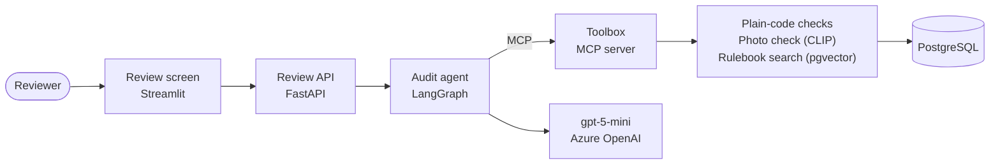

# ListingAudit

[](../../actions/workflows/ci.yml)

An AI agent that audits online shop listings against EU consumer and product-safety rules:
honest discounts (the 30-day price rule of the Omnibus Directive), manufacturer and safety
information (GPSR), unit prices, textile fibre labels, energy labels, and photos that match
the description. It cites the law behind each possible problem, and a person approves every
finding before anything reaches the seller.

**Demo video:** https://youtu.be/PIF6hISSNfA

## How it works



Plain code does every check it can. The language model only decides what code can't: the
kind of product, which law applies, and how to word each finding. Code then checks the
model's draft, so every number comes from a check and every quote from the law texts, and
the report waits until a person approves or rejects each finding.

## Results

On 400 synthetic exam listings that nothing was tuned on, compared with plain rules and with
one big prompt to the model, the agent catches every price problem, 92% of missing
information and label problems and 77% of swapped photos. It raises a false alarm on 5% of
clean listings, and 93% of what it flags is real (51% for one big prompt).

<details>
<summary>Full results</summary>

<!-- results:start -->

Results on the 400 exam listings (python -m listingaudit.eval.grade):

| Question | agent | rules only | one prompt | Target | Agent meets it |
|---|---|---|---|---|---|
| Catches price problems | 100% (90/90) | 100% (90/90) | 100% (90/90) | 90% | yes |
| Catches missing information and label problems | 92% (112/122) | 92% (112/122) | 97% (118/122) | 90% | yes |
| Catches photo swaps | 77% (23/30) | 0% (0/30) | 100% (30/30) | 70% | yes |
| Clean listings with a false alarm | 5% (5/105) | 0% (0/105) | 58% (61/105) | under 5% | yes |
| Tricky but legal listings with a false alarm | 9% (7/75) | 9% (7/75) | 67% (50/75) |  |  |
| Possible problems that are real (precision) | 93% (225/243) | 97% (202/209) | 51% (238/467) |  |  |
| Listings checked against exactly the right rules | 95% (381/400) | 96% (385/400) | n/a | 90% | yes |
| Findings quoting the rule's own law and article | 36% (88/243) | n/a | 67% (312/467) | 95% | no |
| Reports with only real numbers | 100% (400/400) | 100% (400/400) | 67% (269/400) | 100% | yes |
| Fixes that pass the check once applied | 67% (135/202) | n/a | 84% (174/208) | 95% | no |
| Clarity / fairness, judged by a model (1 to 5) | 4.33 / 4.75 | n/a | 1.88 / 2.24 |  |  |
| Judge within one point of a person's grade | n/a | n/a | n/a | most |  |
| Sneaky-note listings with every problem still found | 100% (20/20) | 100% (20/20) | 95% (19/20) | 100% | yes |
| Listings with the same findings in every run | 90% (9/10) | n/a | n/a | most | yes |
| Cost per 1,000 listings (USD, list price) | $3.16 | $0.00 | $2.34 |  |  |
| Minutes per 1,000 listings, one at a time | 165 | 0 | 185 |  |  |

<!-- results:end -->

</details>

## Tech stack

Python, LangGraph, MCP, Azure OpenAI (gpt-5-mini), CLIP, multilingual-e5, PostgreSQL with
pgvector, FastAPI, Streamlit, DeepEval, Langfuse, Docker, Azure Container Apps, Bicep and
GitHub Actions.

## Getting started

You need [Docker Desktop](https://www.docker.com/products/docker-desktop/) and
[uv](https://docs.astral.sh/uv/getting-started/installation/).

```bash
git clone https://github.com/aishwaryaj7/listingaudit.git
cd listingaudit
cp .env.example .env
uv sync
docker compose up -d
```

Load the product catalogue, build the test marketplace and the rulebook, and run the tests:

```bash
uv run python -m listingaudit.data.download_abo
uv run python -m listingaudit.data.load_abo
uv run python -m listingaudit.data.download_images --per-type 100
uv run python -m listingaudit.market.build
uv run python -m listingaudit.rulebook.build
uv run pytest
```

The agent needs a language model: deploy gpt-5-mini on Azure OpenAI and add its endpoint
and key to `.env` as `VISION_BASE_URL`, `VISION_API_KEY` and `VISION_MODEL`. Then audit a
listing, or start the review API and, in a second terminal, the review screen at
http://localhost:8501:

```bash
uv run python -m listingaudit.agent.run P0171
uv run uvicorn listingaudit.review.api:app
uv run streamlit run src/listingaudit/review/screen.py
```

The [full guide](docs/guide.md) covers everything else: the MCP toolbox, the evaluation,
tracing, Docker, and deploying to Azure.

## Project layout

```
src/listingaudit/
  data/       loads the Amazon Berkeley Objects catalogue
  market/     the test marketplace, with planted problems and an answer key
  rulebook/   the law texts, the rules checklist and their search
  checks/     the checks in plain code
  photos/     the photo check
  toolbox/    the MCP server
  agent/      the LangGraph agent and its self-check
  review/     the review API and the review screen
  eval/       the evaluation and its grader
deploy/       the Azure deployment (Bicep)
results/      the evaluation runs
notebooks/    data exploration
tests/        tests
```

## Data and licence

Product data and photos come from the Amazon Berkeley Objects (ABO) dataset by Amazon.com
and UC Berkeley, licensed under [CC BY 4.0](https://creativecommons.org/licenses/by/4.0/)
(Collins, J., et al. "ABO: Dataset and Benchmarks for Real-World 3D Object Understanding."
CVPR 2022). The law texts come from [EUR-Lex](https://eur-lex.europa.eu) (© European Union;
reuse is authorised by Commission Decision 2011/833/EU) and from
[gesetze-im-internet.de](https://www.gesetze-im-internet.de). The models are
[multilingual-e5-small](https://huggingface.co/intfloat/multilingual-e5-small) and OpenAI's
CLIP ViT-B/32 through [open_clip](https://github.com/mlfoundations/open_clip), all under the
MIT licence. Sellers, manufacturers, prices and addresses in the marketplace are made up.

This is a learning project, not legal advice.
