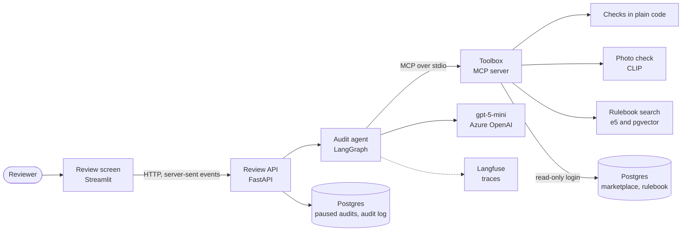
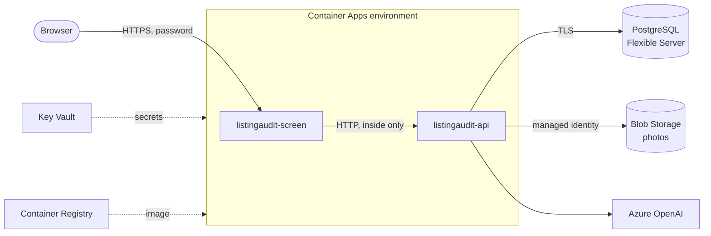

# ListingAudit

[](../../actions/workflows/ci.yml)

ListingAudit is an AI agent that audits online shop listings against EU consumer and
product-safety rules: honest discounts (the 30-day price rule), manufacturer and safety
information (GPSR), unit prices, textile fibre labels, energy labels, and photos that
match the description. It writes an audit report with evidence, and a human reviewer
approves every finding.

> Status: **complete**. All ten steps are built: the data, the rulebook, the checking
> tools, the photo check, the MCP toolbox, the agent, human review, the evaluation with
> tracing and CI, and a Docker image that deploys to Azure Container Apps with Bicep.

## Results

<!-- results:start -->
The results table appears here once the evaluation has run (see "The evaluation" below).
<!-- results:end -->

## How it works



A person starts an audit on the review screen. The API runs the agent, which reads the
listing and runs the checks through the toolbox, and asks the language model only what
code can't settle: the kind of product, the law behind each possible problem, and the
wording of the findings. Code checks the model's draft before anyone sees it. The report
then waits in Postgres until a person approves or rejects each finding.

## What's here

- A Postgres database (in Docker) holding the full
  [Amazon Berkeley Objects](https://amazon-berkeley-objects.s3.amazonaws.com/index.html)
  catalogue: 147,702 product listings and an index of 398,212 product photos.
- Scripts to download the data, clean it, and load it into the database.
- Product photos for a sample of the categories the rules cover
  (textiles, lamps, groceries, cosmetics, candles, furniture).
- **A synthetic German marketplace** built from 800 real products: prices with 90 days of
  price history, sellers, manufacturers, safety information, unit prices, fibre
  compositions and energy labels. There is a practice set and an exam set of 400 listings
  each, made from different products with different random seeds.
- **Planted rule breaks and a secret answer key.** 220 listings in each set break at least
  one rule (fake discounts, missing manufacturer details, wrong unit prices, swapped
  photos, ...), in an easy and a hard version. About 75 more are traps that look wrong but
  are legal. The answer key lives in its own schema that the agent's database login
  cannot read.
- **A rules checklist** (`src/listingaudit/rulebook/checklist.yaml`): for each rule, what to
  check, what looks wrong but is fine, which listing fields hold the evidence, and which
  article of which law it comes from; and which rules apply to which kind of product.
- **A searchable rulebook** in Postgres: nine law texts (EU regulations and directives,
  the Commission's guidance on the 30-day price rule, a Court of Justice judgment, and the
  German Price Indication Ordinance), cleaned with Beautiful Soup and cut into 542 chunks
  that keep their article and paragraph numbers. It offers keyword search (Postgres
  full-text search ranked with BM25), meaning search (pgvector, with the
  `multilingual-e5-small` embedding model running locally) and hybrid search (Reciprocal
  Rank Fusion of the two). Every result carries a citation such as "GPSR Art. 19" and a
  link to the official text.
- **A search evaluation** on 31 test questions: meaning search finds a right article among
  the first five results for 84% of them, hybrid search for 68%, keyword search for 45%.
- **Checking tools in plain code**: the 30-day price rule, checked against the price
  history; the price per kg or litre, including multipacks such as "3 x 250 ml"; the
  fibre composition (EU fibre names, percentages, largest first); and the required
  product information (manufacturer, responsible person in the EU, safety warnings,
  energy label). Each check returns a typed result with one of four statuses (ok,
  problem, not applicable, can't check), the findings with the facts that show them, and
  the articles of law it applies.
- **A score against the answer key**: on the 400 practice listings the checks catch 202 of
  the 212 planted problems they look for, with no false alarms, and none of the traps is
  flagged. The 10 they miss show safety warnings that are there but wrong for the
  product, which takes judgement. Photos that don't match the text need an image model.
- **A photo checker** that compares the photo with the listing's colour field. CLIP
  (OpenAI's ViT-B/32, run locally with open_clip) scores the photo against sentences for
  13 colour families, with no training (zero-shot), and settles the clear cases. The
  photos it can't settle go to a vision language model (gpt-5-mini on Azure OpenAI),
  which answers in a fixed JSON structure, or to the reviewer when none is set up. CLIP's
  two thresholds were picked on spare photos that no practice or exam listing shows.
- **A comparison on the planted photo swaps**: 210 practice listings name one clear
  colour, and 30 of their photos were swapped for a product in another colour. CLIP alone
  catches 8 swaps, with 3 false alarms, and leaves 58 photos (28%) to the reviewer.
  gpt-5-mini alone catches 24 (all 15 easy swaps and 9 of the 15 hard ones) and leaves 1,
  but flags 15 fitting photos. Some of those, such as a "Black" bed base shown in white,
  are real errors in the source catalogue that the answer key doesn't know about. CLIP
  first, with gpt-5-mini deciding only the photos CLIP can't settle, catches 19 with 13
  false alarms and leaves none to the reviewer, for about 0.08 USD per 1,000 listings at
  the list price instead of 0.27.
- **A toolbox for agents**: an MCP server (Model Context Protocol, built with FastMCP from
  the official Python SDK) that any MCP client can start. It offers five read-only tools
  (read a listing, find the rules it has to follow, run the code checks, check the photo,
  search the rulebook), the rules checklist, the law texts and the listing photos as
  resources, and a prompt with the steps of an audit and the template for its report. The
  descriptions and argument schemas are written for the model, every tool returns a typed
  result, and the server reads listings with the agent's read-only database login.
- **An audit agent** built with LangGraph, which talks to the toolbox over MCP. A language
  model judges the kind of product, from a fixed list; code runs the checks the toolbox
  names; the model searches the rulebook for the law behind each possible problem (tool
  calling, at most three rounds), then words the findings and fixes as structured output.
  A self-check in plain code tests every draft: one finding for each problem, quotes only
  from passages the search returned, only the prices and percentages the checks worked
  out, and no legal verdicts. A failed draft goes back with the feedback, and then to a
  larger model if one is set up; a draft that never passes is left out, and the report
  keeps to the checks' own words. Seller text reaches the model only as data, and no note
  in a listing can take a problem out of the report.
- **Human review.** The agent pauses after its report (LangGraph's `interrupt`) and keeps
  its state in Postgres (LangGraph's checkpointer), so a paused review survives a restart.
  A FastAPI service starts audits and streams each step as server-sent events, and a
  Streamlit screen shows each report beside the listing and its photo, where a person
  approves or rejects every finding and can reword its fix. The approved findings make a
  draft message to the seller, which is saved and never sent. Every report and decision
  goes to an audit log that only takes new rows.
- **An evaluation on the 400 exam listings**, which nothing was tuned on. The agent is
  compared with two simpler systems: rules in plain code (the category a listing is filed
  under picks its rules; no AI, no photo check) and one big prompt (the listing, its price
  history, its photo and the rules in one request to the model; no tools). A grader
  scores each system against the answer key: problems caught by kind and difficulty,
  false alarms on clean and on tricky listings, the right rules, the right law and
  article, prices and percentages that no check worked out, suggested fixes that pass the
  check once applied, listings with notes that tell the reviewer to approve them, the
  same findings across five runs, and the cost and time per 1,000 listings.
- **An AI judge**: DeepEval's G-Eval grades each report's clarity and fairness from 1 to
  5, and a person grades 30 of the reports too, to see how often the judge agrees.
- **Tracing with Langfuse**: each audit becomes one trace with its steps, prompts, tool
  calls, tokens and time, and each saved audit keeps its trace id.
- **CI on GitHub Actions**: on every push, the lint, the tests, the grader on the
  committed results, and a build of the Azure deployment's Bicep files. The build fails
  on a made-up number, a legal verdict in a report, or a listing the agent didn't audit.
- **A Docker image** for the review API (which starts the toolbox) and the review screen.
  Every package comes from `uv.lock` except PyTorch, which comes in its CPU build,
  without the 4 GB of CUDA libraries a CPU never uses. The image carries the embedding
  model and CLIP, so a new container starts without downloading anything.
- **A deployment to Azure**, described in Bicep: Container Apps for the API (reachable
  only inside its environment) and the screen (public, behind a password), PostgreSQL
  with pgvector, Blob Storage for the photos, Key Vault for the secrets, and a container
  registry. The apps sign in to the registry, Key Vault and Blob Storage with a managed
  identity, so no key is written into the code or the settings.
- Notebooks exploring the data: `notebooks/01_explore_abo.ipynb`,
  `notebooks/02_explore_market.ipynb`, `notebooks/03_explore_rulebook.ipynb`,
  `notebooks/04_explore_checks.ipynb`, `notebooks/05_explore_photos.ipynb`,
  `notebooks/06_explore_toolbox.ipynb`, `notebooks/07_explore_agent.ipynb`,
  `notebooks/08_explore_review.ipynb` and `notebooks/09_explore_eval.ipynb`.
- Tests for the data cleaning, the marketplace generator (including a check that every
  listing breaks exactly the rules the answer key says it does), the law page parsers, the
  chunking, the checklist, the search, the checking tools (including a check that every
  fibre name in Annex I of the Textile Regulation is accepted), the photo check (with
  stand-ins for the models, so the tests cost nothing), the toolbox (through an MCP
  client, the way an agent uses it), the agent and its self-check (with a scripted
  stand-in for the language model), the review (the pause and the restart, the audit
  log, the API over HTTP in memory, and the screen and its password with Streamlit's test
  harness), the evaluation (the runner, the two simpler systems, the grader, the fix check
  and the judge, with scripted models), the tracing (into memory instead of Langfuse) and
  the photo store (with a stand-in for Blob Storage, and with Azurite, Azure's storage
  emulator, when it runs).

## Quick start

You need [Docker Desktop](https://www.docker.com/products/docker-desktop/) and
[uv](https://docs.astral.sh/uv/getting-started/installation/).

```bash
# 1. Settings (the defaults work as they are)
cp .env.example .env

# 2. Install Python 3.12 and all packages into .venv
uv sync

# 3. Start the database
docker compose up -d

# 4. Download the ABO metadata (~96 MB) and load it into Postgres
uv run python -m listingaudit.data.download_abo
uv run python -m listingaudit.data.load_abo

# 5. Download photos for a sample of listings (~1,900 small photos, about 20 MB)
uv run python -m listingaudit.data.download_images --per-type 100

# 6. Build the synthetic marketplace and its answer key (a few seconds)
uv run python -m listingaudit.market.build

# 7. Download the law texts (~3 MB) and build the rulebook. The first run also
#    downloads the embedding model (~470 MB) into data/models.
uv run python -m listingaudit.rulebook.build

# 8. Run the tests
uv run pytest

# 9. Measure the search on the test questions
uv run python -m listingaudit.rulebook.evaluate

# 10. Score the checking tools on the practice listings, or check one listing
uv run python -m listingaudit.checks.evaluate
uv run python -m listingaudit.checks.run P0099 prior_price

# 11. Score the photo check on the practice listings, or check one photo. The first
#     run downloads CLIP (~600 MB) into data/models.
uv run python -m listingaudit.photos.evaluate
uv run python -m listingaudit.photos.check P0262

# 12. Try the toolbox in the MCP Inspector, in the browser (needs Node.js, see below)
npx @modelcontextprotocol/inspector@2.13.0 -- uv run python -m listingaudit.toolbox.server

# 13. Audit a listing with the agent (needs a language model, see below)
uv run python -m listingaudit.agent.run P0171

# 14. Review audits in the browser: start the review API, then, in a second terminal,
#     the review screen (see below)
uv run uvicorn listingaudit.review.api:app
uv run streamlit run src/listingaudit/review/screen.py

# 15. Grade the saved evaluation (needs neither the database nor a model)
uv run python -m listingaudit.eval.grade

# 16. Explore the data
uv run jupyter lab notebooks/

# 17. Or run the review API and the review screen in Docker (see below)
docker compose --profile app up --build
```

The marketplace build always gives the same data: the random seeds and the marketplace's
"today" (2 November 2026) are fixed, and `uv.lock` pins the exact versions of NumPy and
Faker that generate it.

On Windows PowerShell, use `copy .env.example .env` in step 1. Everything else is the same.

### The vision model on Azure OpenAI

The photo check works without it: photos CLIP can't settle then go to the reviewer. The
agent needs it, as its language models use the same endpoint and key. To set it up:

1. In the Azure portal, create an **Azure OpenAI** resource (pricing tier Standard S0).
2. In its Foundry portal, deploy **gpt-5-mini** with the deployment type
   **Global Standard**, and name the deployment `gpt-5-mini`. If the portal reports
   insufficient quota, the [Quota](https://ai.azure.com/resource/quota) page shows which
   models the subscription can deploy.
3. Copy the key and the resource name from the resource's **Keys and Endpoint** page into
   `.env`:

   ```bash
   VISION_BASE_URL=https://<resource-name>.openai.azure.com/openai/v1/
   VISION_API_KEY=<key>
   VISION_MODEL=gpt-5-mini
   ```

4. Ask the vision model about the practice photos (210 photos, about 10 minutes and
   0.11 USD at the list price), and see the comparison:

   ```bash
   uv run python -m listingaudit.photos.evaluate --vision
   ```

The answers are saved in `data/results`, so later runs and the notebook don't pay for
them again. `VISION_MODEL` is the deployment name, and for the OpenAI API instead of
Azure, leave out `VISION_BASE_URL`. To see how CLIP's thresholds were picked, run
`uv run python -m listingaudit.photos.tune`.

### The toolbox (MCP server)

The checks and the rulebook search are offered to AI agents as an MCP server. An MCP
client starts it as a subprocess and talks to it over stdin and stdout:

```bash
uv run python -m listingaudit.toolbox.server
```

| Tool | What it does |
| --- | --- |
| `get_listing` | Reads a listing as a shopper sees it |
| `rules_for_listing` | Lists the rules a listing has to follow, given the kind of product, and the tool that checks each one |
| `run_checks` | Runs the plain-code checks of some rules |
| `check_photo` | Checks that the photo shows the listing's colour: CLIP first, then the vision model if one is set up |
| `search_rulebook` | Finds the passages of the law texts that answer a question, with citations and links |

Resources: `checklist://rules`, `checklist://rules/{rule}`, `rulebook://laws` and
`listing://{offer_id}/photo`. Prompt: `audit_listing`, the steps of an audit and the
template for its report.

To try it by hand, the [MCP Inspector](https://github.com/modelcontextprotocol/inspector)
opens a test page in the browser. It needs [Node.js](https://nodejs.org) 22.19 or newer.
From the project folder, with the database running:

```bash
npx @modelcontextprotocol/inspector@2.13.0 -- uv run python -m listingaudit.toolbox.server
```

Turn on the server's switch, then open Tools, Resources or Prompts. The Inspector also has
a command-line mode that prints the answers as JSON:

```bash
npx @modelcontextprotocol/inspector@2.13.0 --cli --method tools/call \
  --tool-name get_listing --tool-arg offer_id=P0171 \
  -- uv run python -m listingaudit.toolbox.server
```

To add the server to an MCP client, such as a desktop chat app, add this entry to the
client's server settings, with the path to this folder:

```json
{
  "mcpServers": {
    "listingaudit": {
      "command": "uv",
      "args": ["run", "--directory", "/path/to/listingaudit", "python", "-m", "listingaudit.toolbox.server"]
    }
  }
}
```

If the client can't find `uv`, give its full path, which `which uv` prints.

### The agent

The agent's language models use the endpoint and key of the vision model (see above),
with gpt-5-mini by default. With the database running:

```bash
uv run python -m listingaudit.agent.run P0171 P0198 --save
```

It prints each step as it ends, then the report, the time it took, and the tokens the
models used with their cost at the list price. With `--save`, each audit is also written
to `data/results/agent/`.

An audit is a LangGraph graph. The agent starts the toolbox and keeps one MCP session open
for the whole audit.

| Step | Done by | What it does |
| --- | --- | --- |
| `read_listing` | code | Reads the listing with `get_listing` |
| `pick_rules` | model, code | The model judges the kind of product, and `rules_for_listing` names the rules |
| `run_checks` | code | Runs `run_checks` and `check_photo`; a listing without a possible problem goes straight to its report |
| `look_up_law` | model | Asks for `search_rulebook` searches, for at most three rounds |
| `write_report` | model, code | The model words each finding and its fix; the self-check tests the draft and sends it back with feedback |
| `build_report` | code | Builds the report |
| `human_review` | a person | Pauses the graph until a person approves or rejects each possible problem (review service only) |
| `draft_message` | code | Drafts the message to the seller from the approved findings (review service only) |

The command line runs audits without a review, as batch runs do. The review service below
compiles the same graph with a checkpointer, which adds the last two steps.

`AGENT_MODEL` in `.env` names the deployment of the small model. To have a larger model
take over a draft the small one can't get past the self-check in two tries, deploy it on
the same resource and set `AGENT_MODEL_LARGE` to its deployment name.

### The review screen

Reviews run in two programs: the review API, which runs the agent and keeps the audits,
and the review screen in the browser, which is its client. Start the API (it needs the
language model, like the agent), and in a second terminal the screen:

```bash
uv run uvicorn listingaudit.review.api:app
uv run streamlit run src/listingaudit/review/screen.py
```

The screen opens at http://localhost:8501 (with `SCREEN_PASSWORD` in `.env`, it asks for
that password first, as it does in Azure). Write your name, audit a listing such as
P0171, and watch its steps arrive. The report waits in the list on the left: approve or
reject each finding (a rejection needs a reason), reword the fix if you like, and save.
The approved findings become a draft message to the seller, shown with a copy button.
Nothing is ever sent.

The API's interactive docs are at http://127.0.0.1:8000/docs.

| Endpoint | What it does |
| --- | --- |
| `GET /listings/{offer_id}` | A listing as shoppers see it |
| `GET /listings/{offer_id}/photo` | Its main photo |
| `POST /listings/{offer_id}/audits` | Audits the listing; each step streams as a server-sent event, until the report waits for review |
| `GET /audits` | The audits waiting for review |
| `GET /audits/{audit_id}` | One audit: the report and, once decided, the review and the message draft |
| `POST /audits/{audit_id}/review` | A decision on each possible problem; an incomplete one is refused with what it lacks (422) |
| `GET /log` | The latest entries of the audit log |

A paused audit is a thread of LangGraph's Postgres checkpointer, saved when the graph
pauses, so stopping the API loses nothing: start it again and the same audits wait in
the list. The audit log, the table `review.audit_log`, keeps every report and decision;
the database refuses to change or delete its rows. `REVIEW_SCHEMA` in `.env` moves the
log and the checkpoints to another schema, and `API_URL` tells the screen where the API
runs.

### The evaluation

The evaluation runs three systems on the 400 exam listings and grades them against the
answer key:

| System | What it is |
| --- | --- |
| `agent` | The audit agent above, without the human review |
| `rules_only` | No AI: the category a listing is filed under picks its rules, code checks them, and the photo is left to a person |
| `one_prompt` | One request to the language model with the whole listing, its price history, its photo and the rules in plain words; no tools, no code checks, no rulebook |

The runs save every audit under `results/exam/`, which is committed. The agent and
one_prompt call the paid model; with the database running:

```bash
uv run python -m listingaudit.eval.run agent
uv run python -m listingaudit.eval.run agent --repeats 5 --sample 10
uv run python -m listingaudit.eval.run one_prompt
uv run python -m listingaudit.eval.run rules_only
uv run python -m listingaudit.eval.fixes
uv run --with "deepeval==4.3.4" python -m listingaudit.eval.judge
uv run python -m listingaudit.eval.judge --grade
uv run python -m listingaudit.eval.grade --readme
```

A run carries on where it stopped, and runs failed audits again. `--repeats 5 --sample 10`
audits 10 of the listings four more times, to see whether the findings stay the same.
`eval.fixes` has the model apply each suggested fix to its listing, taking every number
from the fix's own words, and runs the rule's check again. `eval.judge` has DeepEval's
G-Eval grade each report's clarity and fairness from 1 to 5 (`JUDGE_MODEL` in `.env` sets
the judge's deployment, the agent's by default), and `--grade` asks you for your own
grades on 30 of the agent's reports, to see how often the judge agrees with a person.
`--readme` writes the table into the Results section above.

DeepEval isn't one of the project's dependencies: it needs click below 8.4, which would
hold huggingface-hub and transformers back for the whole app. `uv run --with` adds it in a
layer of its own, for that one command.

The grader needs neither the database nor a model, so once the results are committed,
CI runs it on every push. With `--check` it fails when

- the agent didn't audit every exam listing,
- a report states a price or percentage that no check worked out and the listing doesn't
  show,
- a report calls a listing illegal, unlawful, a violation or an infringement, or
- the table in this README is out of date.

The targets in the table are reported, not enforced: the runs aren't repeated in CI,
where they would cost money on every push.

### Tracing with Langfuse

With a [Langfuse](https://langfuse.com) project's keys in `.env`, every run of the agent
becomes a trace: each step of the graph, each prompt and answer, each tool call, the
tokens and the time. Langfuse Cloud has a free plan:

1. Sign up at https://cloud.langfuse.com (the EU region) and create a project.
2. In the project's settings, create an API key.
3. Add the key pair to `.env`:

   ```
   LANGFUSE_PUBLIC_KEY=pk-lf-...
   LANGFUSE_SECRET_KEY=sk-lf-...
   ```

The command line prints a link to each audit's trace. The review service files an audit
and its review under one session, named by the audit's id, with the reviewer as the user,
and the evaluation tags its runs with the system and the split and keeps each trace id in
the run's record. Without keys nothing is traced or sent, and the tests never trace.

A trace holds the listing and the report. The listings here are made up; for real ones,
check where the traces are kept, or run Langfuse yourself and set `LANGFUSE_BASE_URL`.

### Running in Docker

The `Dockerfile` builds one image for the review API and the review screen. Build it
after the quick start, since it takes the models from `data/models`. With the database
running:

```bash
docker compose --profile app up --build
```

The screen opens at http://localhost:8501 and the API at http://localhost:8000, as
before. The containers read `.env`, reach the database by its service name, and read the
photos from `data/images`. The image is built for linux/amd64, the platform Azure runs; on
a Mac with Apple silicon, Docker Desktop emulates it. The first build takes 10 to 20
minutes, and later builds reuse every layer up to the source code.

PyTorch's wheels on PyPI bring CUDA for graphics cards. The image installs every other
package from `uv.lock`, with its hash, and PyTorch in the same version from PyTorch's CPU
index; `--build-arg TORCH=locked` installs `uv.lock` as it is. The app runs as a user
without root rights and writes only to `data/`.

### Deploying to Azure

`deploy/main.bicep` describes the whole deployment:



| Resource | What it's for |
| --- | --- |
| Container App `listingaudit-screen` | The review screen: the only public address, behind a password |
| Container App `listingaudit-api` | The review API with the agent and the toolbox, reachable only inside the environment |
| PostgreSQL Flexible Server (Burstable B1ms) | The marketplace, the rulebook, the paused audits and the audit log, with pgvector |
| Storage account | The listing photos, in a private container |
| Key Vault | The database passwords, the screen password and the model's key |
| Container Registry (Basic) | The image |
| Managed identity | Pulls the image, reads the secrets and reads the photos |
| Log Analytics workspace | The apps' logs |

You need an Azure subscription, the
[Azure CLI](https://learn.microsoft.com/cli/azure/install-azure-cli), Docker running, the
quick start done (for the data and the models), and the language model in `.env` (see
"The vision model on Azure OpenAI"). Then:

```bash
az login
./deploy/deploy.sh
./deploy/load_data.sh
```

`deploy.sh` creates the resource group `listingaudit` in Germany West Central
(`RESOURCE_GROUP` and `LOCATION` choose others), deploys the infrastructure, builds the
image and pushes it to the registry, and then deploys the apps. The first run takes 15
to 30 minutes and ends with the screen's address and the command that shows its
password. It makes the passwords on the first run and keeps them in Key Vault, so a later
run only deploys new code. `load_data.sh` copies the marketplace and the rulebook from
the local database, with `pg_dump` and `psql` from its container, gives the agent its
read-only login, and uploads the photos. The answer key stays on your computer. With
Langfuse keys in `.env`, the apps trace too, in the environment `azure`.

Only the screen has a public address, and it asks for its password. The API is reachable
only from inside the Container Apps environment. The apps read their secrets from Key
Vault and the photos from Blob Storage with their managed identity, and pull the image
with it too: the registry has no admin password and the storage account takes no shared
keys. The database takes only TLS connections, from Azure and from the address you
deployed from, and the agent logs in with its own read-only role. For a team, Entra ID
sign-in (Container Apps' built-in authentication) would replace the screen's password,
and a virtual network with private endpoints would take the database off the internet.

At list prices, the database (about 15 to 20 USD a month) and the registry (about 5 USD a
month) cost money for as long as they exist; a new Azure account gets the database free
for its first 12 months. The apps scale to zero when nobody uses them, and light use
stays within Container Apps' monthly free grant. After a quiet spell, the first visit
waits a minute or two while the containers start; for a demo, keep one of each awake,
and set them back to 0 afterwards:

```bash
az containerapp update --resource-group listingaudit --name listingaudit-api --min-replicas 1
az containerapp update --resource-group listingaudit --name listingaudit-screen --min-replicas 1
```

Container Apps ends a request after 240 seconds, so an audit's stream can't run longer.
To delete everything:

```bash
./deploy/teardown.sh
```

## Project layout

```
db/schema.sql                             tables for the ABO catalogue
db/market.sql                             tables for the marketplace and the answer key
db/rulebook.sql                           tables for the rulebook
db/review.sql                             the audit log of the reviews
src/listingaudit/config.py                settings (read from .env)
src/listingaudit/db.py                    database connection helpers
src/listingaudit/data/abo.py              cleans one raw ABO record into a flat row
src/listingaudit/data/categories.py       which product types matter for which rule
src/listingaudit/data/download_*.py       download scripts
src/listingaudit/data/load_abo.py         loads the data into Postgres
src/listingaudit/market/catalogue.py      picks the products and reads pack sizes, colours, fibres
src/listingaudit/market/prices.py         prices and 90-day price histories
src/listingaudit/market/companies.py      fictional sellers and manufacturers
src/listingaudit/market/rules.py          the rules, in plain words, with their legal sources
src/listingaudit/market/plan.py           decides which listings get which problems and traps
src/listingaudit/market/listing.py        builds one listing, then breaks rules on purpose
src/listingaudit/market/generate.py       builds one split (practice or exam)
src/listingaudit/market/models.py         the data shapes, checked by Pydantic
src/listingaudit/market/build.py          builds both splits and saves them to Postgres
src/listingaudit/rulebook/checklist.yaml  the rules checklist
src/listingaudit/rulebook/checklist.py    reads and checks the checklist
src/listingaudit/rulebook/sources.py      the nine law texts and where they come from
src/listingaudit/rulebook/download.py     downloads the law texts
src/listingaudit/rulebook/parse.py        turns law pages into clean articles
src/listingaudit/rulebook/chunk.py        cuts articles into chunks with citations
src/listingaudit/rulebook/embed.py        the embedding model
src/listingaudit/rulebook/build.py        builds the rulebook in Postgres
src/listingaudit/rulebook/search.py       keyword, meaning and hybrid search
src/listingaudit/rulebook/questions.yaml  test questions with their right answers
src/listingaudit/rulebook/evaluate.py     scores the search methods on the test questions
src/listingaudit/checks/results.py        what a check returns: status, findings, facts, law
src/listingaudit/checks/prior_price.py    the 30-day price rule
src/listingaudit/checks/unit_price.py     the price per kg or litre
src/listingaudit/checks/fibres.py         fibre names and percentages
src/listingaudit/checks/product_info.py   manufacturer, responsible person, warnings, energy label
src/listingaudit/checks/run.py            runs the checks on listings
src/listingaudit/checks/evaluate.py       scores the checks against the answer key
src/listingaudit/photos/colours.py        colour names to colour families
src/listingaudit/photos/clip.py           CLIP's colour scores for a photo
src/listingaudit/photos/vision.py         asks a vision language model about a photo
src/listingaudit/photos/check.py          the photo check: CLIP first, then the vision model
src/listingaudit/photos/tune.py           picks CLIP's thresholds on spare photos
src/listingaudit/photos/evaluate.py       scores CLIP, the vision model and both
src/listingaudit/photos/store.py          finds a listing's photo, in data/ or in Blob Storage
src/listingaudit/toolbox/server.py        the MCP server: tools, resources and a prompt
src/listingaudit/toolbox/audit_prompt.md  the steps of an audit and its report template
src/listingaudit/agent/graph.py           the agent: a LangGraph graph of the audit steps
src/listingaudit/agent/brain.py           the language models, and what the agent asks them
src/listingaudit/agent/report.py          the models' answers, the report, and a person's review of it
src/listingaudit/agent/selfcheck.py       tests a draft report against the tool results
src/listingaudit/agent/toolbox.py         starts the toolbox and connects to it over MCP
src/listingaudit/agent/scripted.py        a scripted stand-in for the model, for tests and notebooks
src/listingaudit/agent/run.py             audits listings from the command line
src/listingaudit/review/log.py            the audit log, in Postgres
src/listingaudit/review/service.py        audits that wait for review, with the checkpointer
src/listingaudit/review/api.py            the review API (FastAPI)
src/listingaudit/review/client.py         a client of the API, for the screen
src/listingaudit/review/screen.py         the review screen (Streamlit)
src/listingaudit/tracing.py               tracing with Langfuse
src/listingaudit/eval/records.py          what an evaluation keeps: the audits and the answer key
src/listingaudit/eval/baselines.py        the two simpler systems: rules only, and one prompt
src/listingaudit/eval/run.py              runs a system on the listings of a split
src/listingaudit/eval/grade.py            grades the runs against the answer key, and the gates
src/listingaudit/eval/fixes.py            applies each suggested fix and checks again
src/listingaudit/eval/judge.py            the AI judge, and a person's grades
results/exam/                             the exam listings, their answer key, and every audit
notebooks/                                data exploration
tests/                                    tests
.github/workflows/ci.yml                  lint, tests, grading and the Bicep build on every push
docker-compose.yml                        the database, and the app in Docker
Dockerfile                                one image for the review API and the review screen
deploy/main.bicep                         the Azure deployment
deploy/main.bicepparam                    its settings, from .env and deploy.sh
deploy/deploy.sh                          deploys the infrastructure, the image and the apps
deploy/load_data.sh                       copies the data and the photos to Azure
deploy/teardown.sh                        deletes the deployment
data/                                     downloaded files (not in git)
```

## Data and licence

Product data and photos come from the Amazon Berkeley Objects (ABO) dataset by
Amazon.com and UC Berkeley, licensed under
[CC BY 4.0](https://creativecommons.org/licenses/by/4.0/).

> Collins, J., et al. "ABO: Dataset and Benchmarks for Real-World 3D Object
> Understanding." CVPR 2022.

The law texts come from [EUR-Lex](https://eur-lex.europa.eu) (© European Union; reuse is
authorised by Commission Decision 2011/833/EU) and from
[gesetze-im-internet.de](https://www.gesetze-im-internet.de) (German laws are official works
without copyright, § 5 UrhG). The embedding model is
[intfloat/multilingual-e5-small](https://huggingface.co/intfloat/multilingual-e5-small)
(MIT licence). The photo check uses OpenAI's CLIP ViT-B/32 (MIT licence) through
[open_clip](https://github.com/mlfoundations/open_clip) (MIT licence).

> Radford, A., et al. "Learning Transferable Visual Models From Natural Language
> Supervision." ICML 2021.

Sellers, manufacturers, prices and addresses in the marketplace are made up. Their email
addresses and websites use the reserved `.example` domain, so none can belong to a real
company.

This is a learning project, not legal advice.
